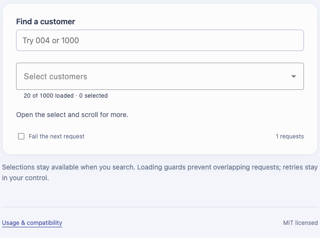
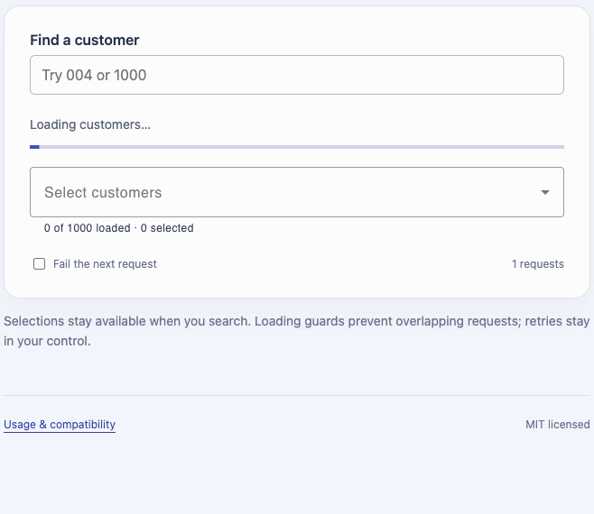

# Angular Material Select Infinite Scroll

Load options in pages as users scroll a standard Angular Material `mat-select`. Supports standalone imports and the existing NgModule API.

## Demo

[Try the live demo](https://haidarz.github.io/ng-mat-select-infinite-scroll/) with 1,000 customers, twenty at a time.

**Load more options as you scroll**



**Search while keeping your selections**



The demo renders the spinner inside the options panel while a page loads; `[loading]` prevents overlapping requests. The [demo component](projects/example/src/app/app.component.ts) also handles search, selection retention, completion, and retry.

## Version compatibility

The **6.0.0-next.0** beta supports Angular/Material **15.2–22**. It is built with Angular 15.2 partial Ivy and tested against the minimum and latest versions of each supported Angular major. See [compatibility.json](compatibility.json) for exact versions and [compat/README.md](compat/README.md) for test commands.

| Your application | Package |
| --- | --- |
| Angular/Material 15.2–22 | `6.0.0-next.0` (`@next`) |
| Angular/Material 15–16 | Existing `5.0.0-beta.3`; excludes the 6.x fixes |
| Angular below 15 | Historical `4.0.0` declares peers `>=6 <15`; verify your exact versions |

Angular and Material should use matching majors. The 6.x line uses RxJS 7.8+. Standard `MatSelect` is covered; `MatLegacySelect` is a separate integration. An older framework's compatibility entry does not extend its upstream security support.

```sh
npm install ng-mat-select-infinite-scroll@next
```

## Standalone usage

```ts
import { Component } from '@angular/core';
import { CommonModule } from '@angular/common';
import { MatFormFieldModule } from '@angular/material/form-field';
import { MatSelectModule } from '@angular/material/select';
import { MatSelectInfiniteScrollDirective } from 'ng-mat-select-infinite-scroll';

@Component({
  standalone: true,
  imports: [CommonModule, MatFormFieldModule, MatSelectModule, MatSelectInfiniteScrollDirective],
  template: `
    <mat-form-field>
      <mat-label>Customer</mat-label>
      <mat-select msInfiniteScroll [loading]="loading" [complete]="complete"
                  (infiniteScroll)="loadNextPage()">
        <mat-option *ngFor="let item of options" [value]="item.id">
          {{ item.name }}
        </mat-option>
      </mat-select>
    </mat-form-field>
  `
})
export class CustomerSelect {
  options: Array<{ id: number; name: string }> = [];
  loading = false;
  complete = false;
  // Fetch the initial page before opening an empty select.
  loadNextPage() { /* guarded server request; see below */ }
}
```

On Angular 22 use `@for (item of options; track item.id) { ... }` instead of the removed `*ngFor`. Configure animations according to your application's Angular/Material version.

For NgModule applications, import `MatSelectInfiniteScrollModule` alongside `MatSelectModule` and `MatFormFieldModule`. Existing `msInfiniteScroll` templates continue to work.

## API

| Input | Default | Behavior |
| --- | --- | --- |
| `complete` | `false` | Suppresses output immediately, including changes while the panel is open. Reset for a new query. |
| `loading` | `false` | Suppresses output while a page is in flight. Bind this to the application's request state. |
| `threshold` | `'15%'` | Distance from the bottom: `0`–`100%`, a pixel string such as `'100px'`, or a numeric string such as `'100'`. |
| `debounceTime` | `150` | Non-negative milliseconds to wait after a scroll event. |

`(infiniteScroll)` emits `void` when more options are needed. Inputs remain live while open. Invalid thresholds and non-finite/negative debounce values throw `RangeError`.

The directive checks the rendered panel on opening, after option changes, and when loading/completion inputs change. This allows a preselected last item or a short page to request more without another scroll. Automatic requests are bounded by changes to the rendered list; a failed or empty response does not cause an automatic retry loop. User scrolling can request again. Close/destroy cancels pending work.

## Loading pages safely

Fetch the first page in your component's initialization. Keep HTTP, offsets, cancellation, errors, and caching in the application:

```ts
loadNextPage() {
  if (this.loading || this.complete) return;
  this.loading = true;
  this.error = null;
  this.api.getCustomers({ query: this.query, offset: this.options.length, limit: 20 })
    .pipe(finalize(() => { this.loading = false; }))
    .subscribe({
      next: page => {
        this.options = [...this.options, ...page.items];
        this.complete = this.options.length >= page.total || page.items.length === 0;
      },
      error: error => { this.error = error; }
    });
}
```

Import `finalize` from RxJS. In a zoneless/OnPush component, use signals or mark the view for checking when asynchronous fields change. Cancel in-flight requests on destruction and query reset; a stale response must not append to a new query. Offer an explicit retry action after an error.

For server search, cancel the previous query (for example with `switchMap`), reset options/page/completion, and request the new first page. Search inputs can live outside `mat-select`; this directive does not implement filtering. For repeated selects in a FormArray, share a data-service cache keyed by query/filter/page and deduplicate in-flight requests there.

## With ngx-mat-select-search

[`ngx-mat-select-search`](https://github.com/bithost-gmbh/ngx-mat-select-search) adds a search input inside the panel; `msInfiniteScroll` requests more pages. Try the **ngx-mat-select-search** example in the [live demo](https://haidarz.github.io/ng-mat-select-infinite-scroll/), or see its [component](projects/example/src/app/app.component.ts) and [template](projects/example/src/app/app.component.html).

Import `FormsModule` and `NgxMatSelectSearchModule` alongside the Material modules and this directive. Connect the search input to your existing page controller:

```html
<mat-select msInfiniteScroll multiple [loading]="loading" [complete]="complete"
            (infiniteScroll)="loadNextPage()">
  <mat-option>
    <ngx-mat-select-search [ngModel]="query" (ngModelChange)="search($event)"
      [searching]="loading" [clearSearchInput]="false"
      [disableScrollToActiveOnOptionsChanged]="true"
      placeholderLabel="Find a customer" noEntriesFoundLabel="No matching customers">
    </ngx-mat-select-search>
  </mat-option>
  <mat-option *ngFor="let item of options" [value]="item.id">{{ item.name }}</mat-option>
</mat-select>
```

For each new query, cancel the previous request, reset pages/completion and the panel's scroll position, then fetch page one. Append later pages for that same query. Retain selected options when replacing results, as shown in the demo. `[clearSearchInput]="false"` keeps the query on close; `disableScrollToActiveOnOptionsChanged` prevents the search component scrolling to the active option during appends.

The demo tests `ngx-mat-select-search` **9.0.0** with Angular 22. Its current peer range is Angular Material **17–22**; Angular 15/16 applications need an older compatible version, such as **7.0.10**. Check the upstream [compatibility table](https://github.com/bithost-gmbh/ngx-mat-select-search#compatibility) before installing. This integration is optional; the library does not depend on the search package.

## Selection and layout

- Append options with stable IDs/identity. When clearing pages or filtering, retain the selected options separately or fetch them by ID; `compareWith` cannot recreate a removed option.
- Keep the Material panel as the scrolling container. Arbitrary nested scrolling `div` elements are not supported. Standard options and optgroups are supported.
- Appending pages preserves the panel's scroll position. **Material can still reset its active keyboard item to the selected option when the option list changes.** See [limitations](docs/RECIPES.md#limitations).

## Migration from 4.x / 5.x

Keep the same selector, output, and NgModule import, or switch to the standalone directive. Add `[loading]` to prevent overlapping requests. Set/reset `[complete]` when your query finishes or changes. Review the stricter threshold validation and the new opening/short-list checks; requests can occur on opening without a new scroll event. Use the compatibility table instead of bypassing npm peers.

## Development

```sh
nvm use
npm ci --ignore-scripts
npm ci --prefix tools/build-library --ignore-scripts
npm test
npm run build
npm run check:policy
```

The library builder intentionally uses Angular 15.2 and Node 18 in isolation. Browser orchestration and publication use Node 24.15. See [compatibility checks](compat/README.md) for per-version commands. Build output, tarballs, and browser receipts are ignored.

The interactive demo uses its own Angular 22 toolchain. After building the library:

```sh
cd projects/example
nvm use
npm ci --ignore-scripts
npm start
```

See [paging and selection recipes](docs/RECIPES.md) for request caching, query resets, and retained selections.

Contributions are welcome. See [CONTRIBUTING.md](CONTRIBUTING.md).

## License

[MIT](LICENSE)
